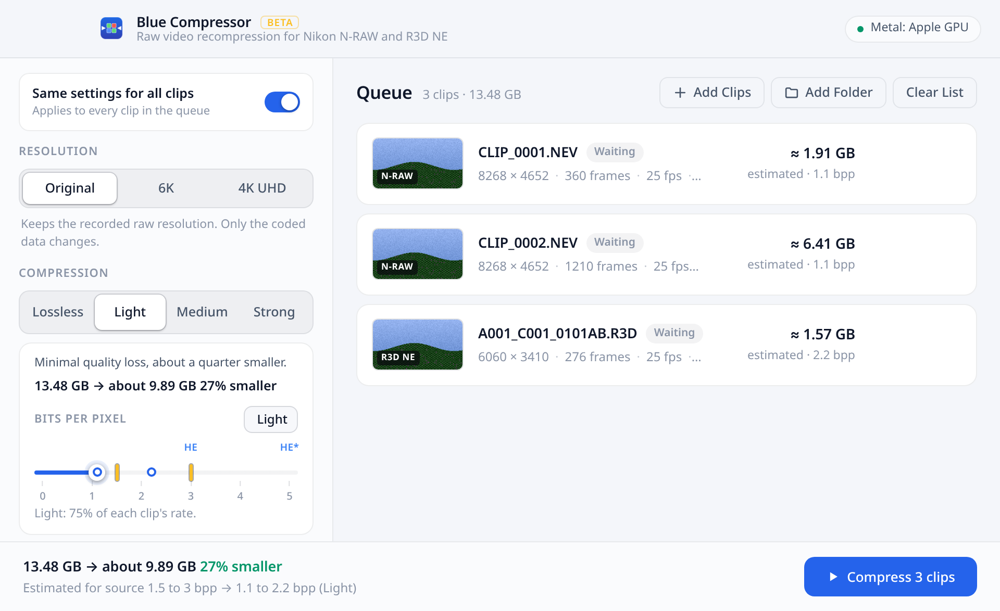

# Blue Compressor

## Download

**[Latest release (v0.2.0 beta)](https://github.com/redn3/blue-compressor/releases/tag/v0.2.0)**. Pick the file for your computer:

| Your computer | Download |
| --- | --- |
| Mac with Apple silicon (M1, M2, M3, M4, M5) | [Blue-Compressor_0.2.0_macOS_arm64.dmg](https://github.com/redn3/blue-compressor/releases/download/v0.2.0/Blue-Compressor_0.2.0_macOS_arm64.dmg) |
| Mac with Intel processor | [Blue-Compressor_0.2.0_macOS_x64.dmg](https://github.com/redn3/blue-compressor/releases/download/v0.2.0/Blue-Compressor_0.2.0_macOS_x64.dmg) |
| Windows 10 or 11 | [Blue-Compressor_0.2.0_Windows_x64-setup.exe](https://github.com/redn3/blue-compressor/releases/download/v0.2.0/Blue-Compressor_0.2.0_Windows_x64-setup.exe) |
| Linux (any distribution) | [Blue-Compressor_0.2.0_Linux_x64.AppImage](https://github.com/redn3/blue-compressor/releases/download/v0.2.0/Blue-Compressor_0.2.0_Linux_x64.AppImage) |
| Docker / Synology NAS (`amd64` and `arm64`) | `docker pull ghcr.io/redn3/blue-compressor:latest` ([setup guide](#docker-and-synology-nas)) |

Not sure which Mac you have? Open the Apple menu and choose About This Mac. If it says "Chip", get Apple silicon; if it says "Processor" with Intel, get Intel.

Other formats (Windows `.msi`, Linux `.deb` and `.rpm`) and the command line tool are on the [release page](https://github.com/redn3/blue-compressor/releases/tag/v0.2.0).

Blue Compressor makes Nikon **N-RAW** (`.NEV`, e.g. Z8, Z9, Z6III) and **R3D NE**
(`.R3D`, e.g. Nikon ZR) clips smaller. It re-encodes the TICO RAW (JPEG XS) data inside
them and keeps everything else as it was: the raw Bayer data stays raw, and the
container, metadata, timecode and audio are untouched. The output is an ordinary clip
meant to open in the same software as the camera originals.

There is a desktop app (macOS, Windows, Linux) with drag and drop and a before/after
quality previewer. There is also a headless command line tool and a C API for scripts
and build servers.

In the queue (desktop app and Web UI), **Pause** holds the running clip where it is and
**Resume** continues it; **Stop** still cancels, also while paused. **Clear List** empties
the list when nothing is running; while compressing it removes only the finished clips.
Each clip is written to a temporary file and renamed when it is complete, so an interrupted
run (a crash, or a NAS or container restart) never leaves a broken clip under the final
name. Clips whose compressed copy for the current setting and output folder already exists are
marked **Already done** as soon as they are added (and again when you change a setting),
left out of the Compress count, and summed up in the queue header, so adding the same folder
again after an interruption only compresses the clips that are left. Use **Compress again**
on such a clip to force a new version. While a queue runs, the footer shows the space saved
so far by this batch (finished clips exactly, the clip in progress estimated) and how many
clips are done; clips that were already done are counted separately in the queue header.

For anamorphic footage, the previewer has a **De-squeeze** setting (None, 1.25x, 1.33x, 1.5x,
1.55x, 1.6x, 1.8x, 2x or a custom factor from 1 to 3) that stretches the preview and the queue
thumbnails sideways so the image shows in its intended shape. It is display only: the raw
data and the compressed clips are never changed. The choice is remembered with the other
settings.

### Updates

The desktop app checks for a new version a few seconds after it starts and once a day while
it is open. When there is one it asks **Blue Compressor 0.2.1 is available. Update now?**
with a few lines on what is new: **Update** downloads it, checks its signature, installs it
and reopens the app; **Later** asks again next time; **Skip this version** waits for the
one after. It never updates in the middle of a batch: while the queue is compressing it
offers to update when the queue has finished. Turn **Check for updates** off in the
sidebar to stop the daily check, or use **Check Now** at any time. The Linux `.deb` and
`.rpm` packages cannot replace themselves, so there (and if an install fails) the prompt
opens the release page instead. Versions before 0.2.0 have no updater: install 0.2.0 once
by hand and later versions can update themselves.

The Docker image and the Web UI never replace themselves. The server checks GitHub every 12
hours and the Web UI shows a banner with the steps to update the container (see
[Docker and Synology NAS](#updating-the-container)).

**Privacy:** the only request is an anonymous read of the newest release from GitHub
(`github.com/redn3/blue-compressor/releases/latest`). Nothing about you, your computer or
your clips is sent, and when you are offline the check simply does nothing.



> **Status: early and experimental.** It has been tested on one Z8 clip and one ZR clip,
> on macOS (Apple silicon). Keep your originals until you have checked the outputs in
> your own pipeline.

## What it does

Compression is set as a size in **bits per pixel** (bpp): the coded size of a frame
times 8, divided by its width times height. Only the TICO RAW codestream counts: the
container (headers, audio, metadata, index) and each frame's small NRAW header are left
out. A clip's own rate is measured from the frame sizes in the container's index less the
frame header length (read from a few frames, not the whole clip), so scanning a card
stays fast. `bluecompress probe` and the app show each clip's own rate; Nikon's own HE stills come out at about 3 bpp and HE\* at about 5 (see
the credit below). Four quick picks set it for you:

| Pick | What happens | Size |
| --- | --- | --- |
| **Lossless** | Repacks the coded data without the camera's padding. Every decoded pixel is identical. | Z8 8K N-RAW 2.60 GB to 2.36 GB (−9%), ZR 6K R3D NE 2.14 GB to 2.05 GB (−4%) |
| **Light** (default) | 0.75 × each clip's own bits per pixel. Minimal quality loss. | about 25% smaller |
| **Medium** | 0.55 × each clip's own bits per pixel. Balanced, good for archive copies. | about 45% smaller |
| **Strong** | 0.35 × each clip's own bits per pixel. Smallest files, for reference copies. | about 65% smaller |

Light, Medium and Strong work out a value for each clip from its own rate (rounded to
0.1, at least 0.5), so a batch of clips recorded at different settings each shrinks by
the same share; the slider marks the value for each clip. Dragging the slider (0 to 5) or typing
a number from 0.5 to 8 sets one bpp for every clip instead. The lossless sizes
were measured on one sample clip from each camera. The other sizes follow from the target
because every frame is rate controlled to fit it (see below), so they hold on any footage
(unless the 0.5 floor or the lossless repack comes first); how the picture holds up at a
given bpp depends on content and ISO, so check the
previewer on your own clips. Lossless outputs decode to exactly the same coefficients as
the originals.

Resizing to **6K** (6048 × 3402) or **4K UHD** (3840 × 2160) area-scales each CFA colour
plane in linear raw and re-encodes at the chosen bpp of the smaller frame. Measured with
the earlier Q2 preset, that took the Z8 clip to 0.94 GB (−64%) at 6K and 0.49 GB (−81%) at
4K, and the ZR clip to 0.56 GB (−74%) at 4K.

Speed on a recent Apple silicon laptop, measured with the earlier fixed quality steps: about
40 to 55 fps at the original resolution (entropy decoding and encoding on all CPU cores); a
bpp target costs more CPU time, see below. 8K to 6K runs at about 31 fps with Metal and
12 fps on the CPU alone.

### How it works

TICO RAW is a JPEG XS variant: four Star-Tetrix decorrelated components on the 2 × 2
Bayer quad grid, a 5/3 wavelet (five horizontal levels, one vertical), and a
square-root companding transfer curve. Blue Compressor:

* **Original resolution**: entropy-decodes every precinct and requantizes the coefficients
  with a coarser truncation (never finer than the camera's). It then re-encodes with the
  cheapest coding modes and rebuilds the container's sample tables. Nothing is
  transformed, so there is no generation loss beyond the chosen quantization.
* **6K / 4K**: decodes fully to the Bayer mosaic, then converts to linear raw. It
  area-resamples each CFA plane with phase-correct footprints (a box filter, so no
  ringing next to clipped highlights) and runs the forward transforms again. The
  geometry stages run on the GPU (Metal on macOS, optional CUDA and OpenCL); entropy coding stays
  on the CPU.

### Rate control

* Each frame is rate controlled to fit `bpp × width × height / 8` codestream bytes,
  rounded down to whole KiB because frames are stored KiB padded as the cameras write
  them, so source and output are measured the same way. The first pass
  is the finest coding allowed (the lossless repack, or the resizer's finest setting);
  if that fits, it is the output. Otherwise the budget is shared over the slices and
  precincts in proportion to their sizes in that pass, each precinct takes the finest
  quantization that fits its share, and any bytes it leaves go to the ones after it.
  Coding is never finer than the camera's.
* A target at or above the clip's own rate gains nothing and gives the lossless repack.
* Each precinct first tries the setting the same precinct took in the previous frame, and
  keeps it when it fits with little to spare, so most precincts are coded once or twice.
  Frames are rate controlled in fixed runs of four, so the output does not depend on the
  thread count.
* Targets go from 0.5 to 8 in 0.1 steps. Output is deterministic, whatever the thread
  count. It works at the original resolution and with 6K or 4K resizing, on every
  backend (the GPU does the resizing; rate control is part of the entropy coding, which
  is on the CPU). It costs more CPU time than the lossless repack, because some
  precincts are coded more than once to find the finest fit; reusing the previous
  frame's setting keeps that to about 1.3 to 1.9 codings per precinct on average.

The bits per pixel measure and the HE and HE\* figures come from *Nikon HE and HE\* RAW:
Format analysis and decoding reference* (sections 2.1 and 2.2), copyright (c) 2026
patrol_taking_9j (RdWing), licensed under
[CC BY-SA 4.0](https://creativecommons.org/licenses/by-sa/4.0/).

### Proxies

Turn on **Make H.265 proxies** (or pass `--proxies`, or set `PROXIES` / `WATCH_PROXIES`
in Docker) to also write an editing proxy of each clip to a `Proxies` folder next to its
output, as `Proxies/<clip name>.mov`, so editors that relink proxies by name find them.
Each proxy is 10-bit H.265 (HEVC Main10, 4:2:0) in Rec.709, up to 1920 wide (half the
sensor resolution at most), with the clip's first audio track as AAC. The picture is
debayered at half resolution (one pixel per 2x2 sensor block) with a simple display
grade (white balance and exposure measured once per clip), so it is meant for cutting,
not for judging color.

Encoding runs in a separate `ffmpeg`, on the GPU when one of its encoders works
(VideoToolbox on a Mac, NVENC, Quick Sync or AMF elsewhere) and with libx265 on the CPU
otherwise, which is what a NAS without a GPU uses. The Docker image includes ffmpeg; on
a computer, Blue Compressor uses an `ffmpeg` next to itself, the one in
`BLUECOMPRESS_FFMPEG`, or one on the PATH (Homebrew's folders included).

### R3D NE from N-RAW

Turn on **Convert .nev to R3D NE** (or pass `--r3d`, or set `R3D` / `WATCH_R3D` in
Docker) to also write an R3D NE copy of each Nikon ZR `.nev` clip in the list to an
`R3D NE` folder next to its output, as `R3D NE/<clip name>.R3D` (ZR names such as
`A007_C002_10299S` are already RED style; other names get one). `.r3d` clips in the list
are left alone.

R3D NE on the ZR is the same TICO RAW data as N-RAW High in a slightly different
wrapper, so the conversion copies the original clip byte for byte and rewrites only the
tags that differ: the video codec (`NRAW` to `NR3D`), the format codes, the gamma and gamut
(N-Log to Log3G10, Rec.2020 to REDWideGamutRGB, which decoders apply when debayering), the
RED clip metadata, the camera matrix and a few RED constants. Nothing is re-encoded, so
it takes about as long as copying the file.

It always converts the original `.nev`, never the compressed copy, because R3D NE only
exists at N-RAW High quality (about 3 bits per pixel); the compression setting still
applies to the normal output. N-RAW Normal clips and clips from other cameras (Z8, Z9),
which have no R3D NE equivalent, are skipped with a note on the job.

R3D NE records about one stop brighter than N-RAW at the same ISO, so the converted clip
is tagged with twice the clip's ISO (800 is written as 1600) for RED decoders to
match the brightness. This is still being checked against real clips.

## Repository layout

```
crates/core      Rust library: codec, container, transcoder, GPU backends, C API
crates/cli       `bluecompress` command line tool
app/src-tauri    desktop app (Tauri 2) and app/ui (HTML, CSS, JS, no build step)
```

## Building

You need [Rust](https://rustup.rs) 1.88 or newer.

```bash
cargo build --release -p bluecompress-cli
./target/release/bluecompress --help
```

This also builds the core library: `target/release/libbluecompress.{a,dylib,so}` or
`bluecompress.{lib,dll}`. Its C header is `crates/core/include/bluecompress.h`.

GPU backends (the Windows and Linux desktop app and release CLI builds include both `cuda` and `opencl`):

* **Metal** is on by default on macOS (the shaders are compiled at run time).
* **CUDA** (NVIDIA) is behind a feature flag: `cargo build --release -p bluecompress-cli --features cuda`.
  The CUDA driver and NVRTC are loaded at run time, so building needs no CUDA toolkit.
  NVRTC is not part of the NVIDIA driver and has to be installed separately. On Windows it
  must be NVRTC **12.x** (`nvrtc64_120_0.dll` plus its `nvrtc-builtins64_12*.dll`), next to
  `bluecompress.exe` or on `PATH`; NVRTC 13 (`nvrtc64_130_0.dll`) is not picked up.
  Verified on Windows 11 with an RTX 4060 Ti; Linux and other NVIDIA GPUs are not yet
  tested. Compare its output against `--backend cpu` before relying on it, and please
  report results.
* **OpenCL** (AMD and other GPUs) is behind a feature flag:
  `cargo build --release -p bluecompress-cli --features opencl`. The OpenCL loader
  (`OpenCL.dll` / `libOpenCL.so`) is opened at run time, so building needs no SDK and
  machines without a driver fall back to the CPU. Requires double precision (`cl_khr_fp64`)
  to match the CPU output bit for bit. Verified against PoCL in CI, not yet tested on real
  AMD hardware; please report results.

### Desktop app

```bash
cargo install tauri-cli --version "^2"
cd app/src-tauri
cargo tauri dev          # run in development mode
cargo tauri build        # release bundle (.app/.dmg, .msi/.exe, .deb/.AppImage)
```

The app writes each version into a folder named after its setting, next to the clip
(`Compressed 1.2bpp/`, `Compressed 0.9bpp 4K/` or `Compressed Lossless/`), and keeps the file names so edits relink. Use
**Compress again** on a finished clip to make another version with different settings.

Platform prerequisites are listed in the [Tauri guide](https://v2.tauri.app/start/prerequisites/).
On Linux that means the WebKitGTK and build packages it names; on Windows, WebView2,
which current Windows versions already have. The UI is plain HTML, CSS and JavaScript in
`app/ui`, with no Node toolchain. For UI work without footage, build with
`--features mock`, which fakes the engine with realistic numbers.

## Command line

```bash
# Compress a folder (recursively) into another folder at the default, light
# (0.75 x each clip's own bits per pixel)
bluecompress compress /Volumes/CARD -o /Volumes/Archive/compressed

# Medium: 0.55 x each clip's own bits per pixel
bluecompress compress --preset medium /Volumes/CARD -o /Volumes/Archive/compressed

# One clip, explicit output, 6K at 1.5 bits per pixel on the GPU
bluecompress compress --bpp 1.5 -r 6k clip.NEV --output clip_6k.NEV

# Pixel-identical repack
bluecompress compress --lossless footage/ -o out/

# Machine-readable progress for build servers (one JSON object per line)
bluecompress compress --json --skip-existing footage/ -o out/

# Watch a folder for incoming clips (add --clear-watch to remove sources after compression)
bluecompress watch --input /watch/in --output /watch/out --bpp 1.8 -r original

# Start the Web UI server (port 9847 by default) with optional background watch folder
bluecompress serve --listen 0.0.0.0:9847 --watch-input /watch/in --watch-output /watch/out

bluecompress probe --json clip.R3D
bluecompress backends
```

Options: one of `--bpp 0.5..8`, `--preset light|medium|strong` (0.75, 0.55 or 0.35 × each
clip's own bits per pixel; the default is light) or `--lossless`, `-r original|6k|4k`, `-b auto|cpu|metal|cuda|opencl`, `-j threads`,
`--suffix`, `--overwrite`, `--skip-existing`, `--json`, `--quiet`.

* **Legacy `-q` / `--quality`**: kept so existing scripts keep working, with one note on
  stderr. `-q 1` is `--lossless`; `-q 2`, `-q 3` and `-q 4` are `--preset light`,
  `medium` and `strong`. It cannot be combined with `--bpp`, `--preset` or `--lossless`.
* **Writing outputs**: each output goes to `<name>.partial` and is renamed when
  complete. Originals are never modified. Ctrl+C cancels cleanly.
* **Exit codes**: 0 success, 1 a clip failed, 2 usage error, 3 cancelled.
* **JSON events**: `start`, `progress`, `done`, `skipped`, `error`, `summary`. The `probe`
  command emits `clip` events instead, with each clip's source `bpp`. The `start` event
  carries the clip's `bpp` target (null for lossless), `lossless` and `source_bpp`.
* **Folders**: the app and the Web UI (`serve`) write next to each clip into a folder
  named after the setting: `Compressed 1.2bpp/`, `Compressed 2bpp 4K/` or
  `Compressed Lossless/`.

## Docker and Synology NAS

The official multi-arch image (`ghcr.io/redn3/blue-compressor:latest`, built for both `linux/amd64` and `linux/arm64`) packs three modes into one container:

1. **Web UI on port `9847`**: the full Blue Compressor interface in your browser, with a server-side folder browser for NAS shares, live queue progress, and the before/after quality previewer. The queue runs on the server: reloading or closing the page does not stop it, and the page restores the clips, progress and pause state when you open it again. You can add more clips while it runs.
2. **Watch-folder daemon**: watches `/watch/in` recursively for `.NEV` and `.R3D` clips, waits for incoming SMB/AFP network copies to finish (size and modification time stable across polls), and writes compressed copies to `/watch/out` atomically while preserving subfolder structure.
3. **Command line (`bluecompress`)**: pass any subcommand (`compress`, `probe`, `watch`, `backends`) to run it directly.

### Quick start (`docker run`)

```bash
docker run -d \
  --name blue-compressor \
  --restart unless-stopped \
  -p 9847:9847 \
  -v /path/to/your/media:/media \
  -v /path/to/your/watch-in:/watch/in \
  -v /path/to/your/watch-out:/watch/out \
  -e WATCH_BPP=1.8 \
  -e WATCH_RESOLUTION=original \
  ghcr.io/redn3/blue-compressor:latest
```

Then open `http://<nas-ip>:9847` in your browser.

### Docker Compose / Synology Container Manager

A ready-to-use [`docker-compose.yml`](docker-compose.yml) is included at the repository root:

```yaml
services:
  blue-compressor:
    image: ghcr.io/redn3/blue-compressor:latest
    container_name: blue-compressor
    restart: unless-stopped
    ports:
      - "9847:9847"
    environment:
      - PORT=9847
      - BROWSE_ROOT=/
      - WATCH_ENABLED=true
      - WATCH_INPUT=/watch/in
      - WATCH_OUTPUT=/watch/out
      # Compression: PRESET and WATCH_PRESET are lossless, light, medium or strong
      # (light, medium and strong are 0.75, 0.55 and 0.35 x each clip's own bits per pixel).
      # Set BPP or WATCH_BPP instead for a fixed size in bits per pixel, for example 1.8.
      # The older QUALITY and WATCH_QUALITY (1 to 4) still work.
      - PRESET=light
      - RESOLUTION=original
      - WATCH_PRESET=light
      - WATCH_RESOLUTION=original
      - WATCH_POLL_SECONDS=5
      - WATCH_CLEAR=false
      - UPDATE_CHECK=true
    volumes:
      # Replace the left side of each mapping with existing folders on your NAS or host
      # (for example /volume1/video:/media on Synology):
      - /path/to/your/media:/media
      - /path/to/your/watch-in:/watch/in
      - /path/to/your/watch-out:/watch/out
```

> **Note:** Replace `/path/to/your/...` on the left side of each volume mapping with real folders that already exist on your NAS or host (or remove the `/watch/in` and `/watch/out` lines if you only want the Web UI). On Synology DSM, **Container Manager** refuses to start a project if any mapped host folder does not exist yet, so create those folders in **File Station** first, then open **Container Manager** > **Project** > **Create**, paste the `docker-compose.yml` above with your paths, and build.

### Environment variables

| Variable | Default | Description |
| --- | --- | --- |
| `PORT` | `9847` | Port for the Web UI server (`0.0.0.0:$PORT`). |
| `BROWSE_ROOT` | `/` | Root directory accessible in the Web UI file browser. |
| `WATCH_ENABLED` | `true` | Set to `false` or `0` to disable the background watch-folder loop. |
| `WATCH_INPUT` | `/watch/in` | Folder watched recursively for incoming `.NEV` and `.R3D` clips. |
| `WATCH_OUTPUT` | `/watch/out` | Destination folder for watch-folder outputs (relative paths kept). |
| `BPP` | unset | Default size in bits per pixel (`0.5`..`8`) for the Web UI, instead of the preset (and fallback for `WATCH_BPP`). |
| `PRESET` | `light` | The Web UI's starting pick: `lossless`, `light`, `medium` or `strong` (0.75, 0.55 and 0.35 × each clip's own bits per pixel). Fallback for `WATCH_PRESET`. |
| `QUALITY` | unset | Older form of `PRESET`: `1` lossless, `2` light, `3` medium, `4` strong. `PRESET` wins when both are set. |
| `RESOLUTION` | `original` | Default resolution (`original`, `6k`, `4k`) for the Web UI (and fallback for `WATCH_RESOLUTION`). |
| `WATCH_BPP` | unset | Size in bits per pixel (`0.5`..`8`) for every watch-folder clip, instead of the preset. Also adjustable live in the Web UI. |
| `WATCH_PRESET` | `light` | Pick for watch-folder jobs, relative to each clip: `lossless`, `light`, `medium` or `strong`. Choosing a pick in the Web UI switches to it. |
| `WATCH_QUALITY` | unset | Older form of `WATCH_PRESET` (`1` to `4`). `WATCH_PRESET` wins when both are set. |
| `WATCH_RESOLUTION` | `original` | Output resolution for watch-folder jobs (`original`, `6k`, `4k`), also adjustable live in the Web UI. |
| `WATCH_POLL_SECONDS` | `5` | Seconds between watch-folder scans and file-copy stability checks. |
| `WATCH_CLEAR` | `false` | Set to `true` (or toggle **Clear watch folder after process** in the Web UI) to delete source clips from `WATCH_INPUT` once compression succeeds. |
| `PROXIES` | `false` | Set to `true` to turn on **Make H.265 proxies** for new Web UI jobs (see Proxies above). |
| `WATCH_PROXIES` | `false` | Set to `true` to also write a proxy of every watch-folder clip. A proxy that fails keeps the source even with `WATCH_CLEAR`. |
| `R3D` | `false` | Set to `true` to turn on **Convert .nev to R3D NE** for new Web UI jobs (see R3D NE from N-RAW above). |
| `WATCH_R3D` | `false` | Set to `true` to also convert every watch-folder `.nev` to R3D NE. A failed conversion keeps the source even with `WATCH_CLEAR`. |
| `UPDATE_CHECK` | `true` | Set to `false` to stop the update check (an anonymous request to the GitHub releases API at start and every 12 hours; the Web UI then shows no update banner). |

### Updating the container

A container never updates itself. When a new version is out, the Web UI shows a banner
(you can hide it until the next version) and the server log has one line about it. To
update:

1. **Synology Container Manager:** open **Project**, select the Blue Compressor project and
   click **Stop**. Under **Image**, delete the old `ghcr.io/redn3/blue-compressor` image (or
   change the image tag in `docker-compose.yml` to the new version, for example
   `ghcr.io/redn3/blue-compressor:0.2.0`). Then build or start the project again; it
   downloads the new version.
2. **Docker Compose:** `docker compose pull`, then `docker compose up -d`.
3. **Docker:** `docker pull ghcr.io/redn3/blue-compressor:latest`, then remove and recreate
   the container with the same settings.

Your settings, watch folders and compressed clips are kept.

### One-off CLI runs with Docker

Because the image `ENTRYPOINT` is `bluecompress`, you can also invoke any CLI command directly:

```bash
docker run --rm -v "$PWD":/data ghcr.io/redn3/blue-compressor:latest \
  compress --bpp 1.5 /data/clip.NEV --output /data/clip_1.5bpp.NEV

docker run --rm -v "$PWD":/data ghcr.io/redn3/blue-compressor:latest \
  probe /data/clip.NEV
```

## C API

`crates/core/include/bluecompress.h` declares the following:

* `bc_probe`
* `bc_output_size`
* `bc_transcode` (synchronous, with a progress and cancel callback; its `quality` field is
  the legacy step: 1 lossless, 2 to 4 are 0.75, 0.55 and 0.35 × the clip's own bits per pixel)
* `bc_transcode_bpp` (the same with a size in bits per pixel; 0 or less means lossless)
* `bc_clip_bpp` (a probed clip's own bits per pixel, from `codestream_bytes`, which
  `bc_clip_info` carries next to `video_bytes`)
* `bc_backend_description`
* `bc_version`

Every call catches panics, so nothing unwinds into C. On Windows, define
`BC_SHARED_USE` when linking the DLL.

## Testing

```bash
cargo test --release -p bluecompress
```

The unit tests cover bit I/O, the reversible transforms and the resampling taps. Camera
footage is not in the repository; to run the end-to-end tests against your own clips,
point `BC_TEST_CLIPS` at a folder of `.NEV` / `.R3D` files:

```bash
BC_TEST_CLIPS=~/footage cargo test --release -p bluecompress --test clips -- --nocapture
```

These check that the lossless repack decodes to identical coefficients, and that lossy and 4K outputs
parse and decode.

### Checking outputs

Before relying on this for archival, open compressed copies in the software you use for
those clips, compare them with the originals, and check metadata, audio and timecode.

### Determinism

Output is deterministic for a given build and backend, whatever the thread count. At the
original resolution only integer arithmetic is involved, so outputs are bit-identical on
every platform and backend. Resizing uses float
arithmetic, so CPU, Metal and CUDA outputs, and builds for CPUs with and without FMA,
differ in a few hundred of several million coefficients per frame. The differences
are one quantization step each: float rounding, with no visible effect.

## Contributing

See [CONTRIBUTING.md](CONTRIBUTING.md). Bug reports with a short sample clip, or test
results from cameras, platforms and GPUs not yet covered, are especially welcome.
Security issues: see [SECURITY.md](SECURITY.md).

## Legal

Blue Compressor is licensed under the [Apache License 2.0](LICENSE). See
[NOTICE](NOTICE) for attributions.

* It is an independent project. It is **not affiliated with, endorsed by or supported
  by** Nikon, RED Digital Cinema or intoPIX. Nikon, N-RAW, RED, R3D, R3D NE, REDCODE,
  TICO and TicoRAW are trademarks of their respective owners. They are used here only
  to describe the files this software reads and writes.
* This repository contains no code, headers, libraries or documentation from Nikon, RED
  or intoPIX, and the software does not use, include or require any vendor SDK. The codec
  follows the public JPEG XS standard (ISO/IEC 21122); see NOTICE for the open-source
  references consulted.
* JPEG XS and TICO RAW may be covered by patents in some countries; intoPIX runs a
  licensing program for them. The Apache 2.0 license grants rights only to the
  contributors' own patents, not to third parties' patents. Whether you need a patent
  license to use this software is for you to determine.
* The software is provided "as is", without warranty of any kind (see the license).
  Archival tools can lose data: verify outputs before deleting any originals.
